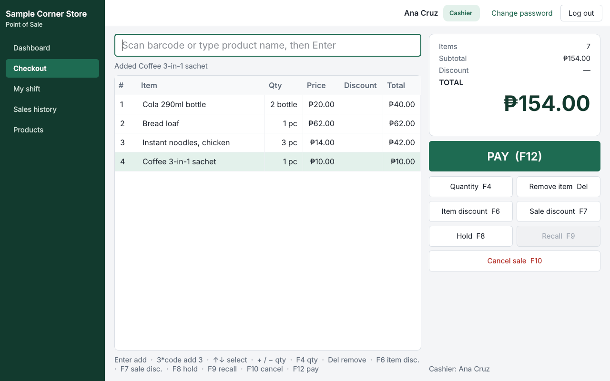
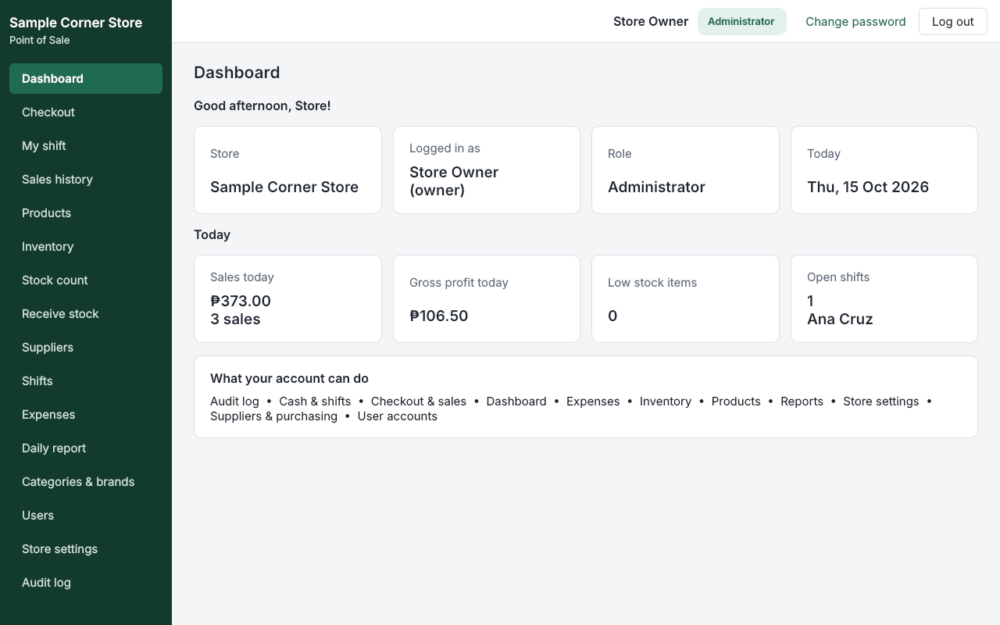
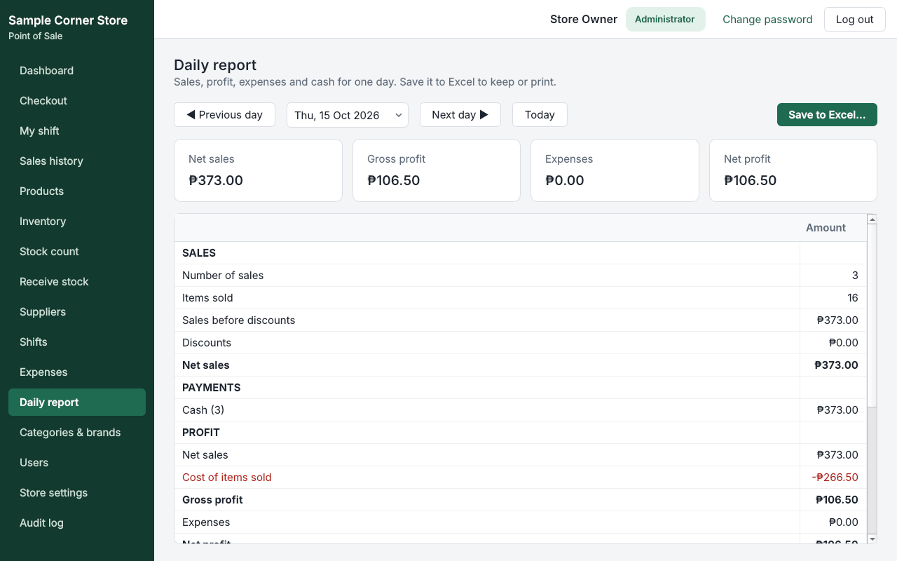
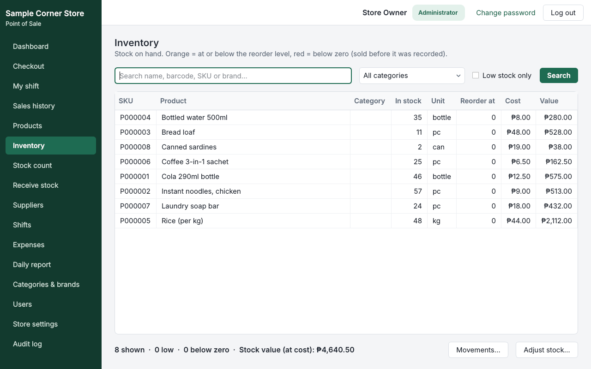
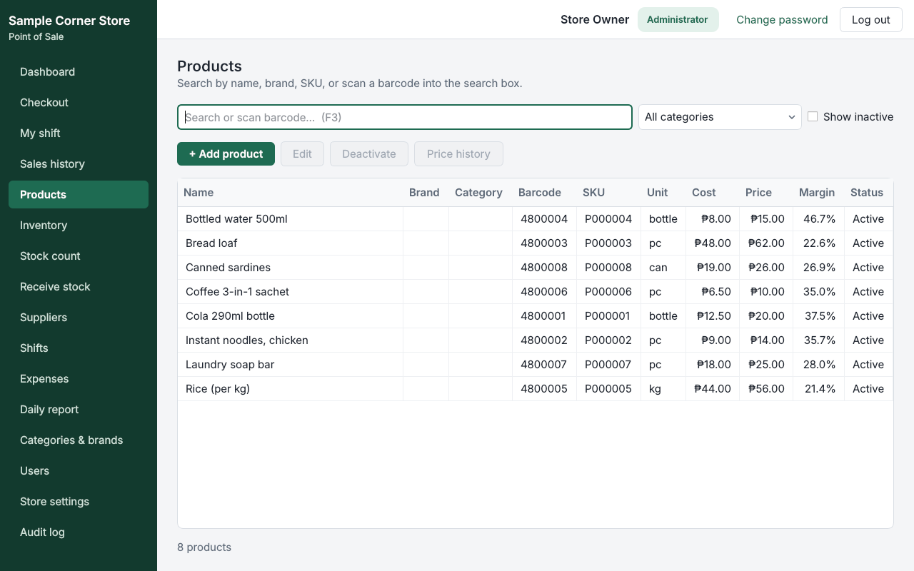

# Convenience Store POS

A Windows desktop point-of-sale and back-office system for a small convenience store, covering
checkout, inventory, receiving, cash-drawer shifts, expenses, daily profit reporting, role-based
access, an audit trail, and automatic database backups.

**Python 3 · PySide6 (Qt) · MySQL / MariaDB · pytest · PyInstaller**



> **Status: Completed (v1.0.0).** All 12 planned phases are built, and 143 automated tests pass
> (unit, database integration and off-screen UI tests). The packaged program has been tested against
> a real database on the development PC. Installation on the store PC is the remaining step.
>
> Screenshots use fictional sample data, not real store records.

---

## The problem

A small neighbourhood store needed to replace manual sales and stock records with something the
owner and cashiers could use every day without IT support. It had to:

- run on an ordinary Windows PC with a USB barcode scanner and a small thermal receipt printer;
- keep working with **exact money** (no floating-point rounding) and weighed items such as rice per kg;
- stop the usual cash problems: unrecorded voids and discounts, drawer shortages nobody can explain,
  stock that "disappears";
- show the owner each day's **sales, cost of goods sold, expenses and profit**;
- never lose data. That means backups, safe database upgrades, and records that cannot be silently deleted.

## Key features

| Area | What it does |
|---|---|
| **Checkout** | Barcode or name search, quantity prefix (`3*code`), weighed items, item and sale discounts with reasons, split payments (cash, GCash, card…), hold and recall, keyboard-first (F-keys) |
| **Receipts** | 58/80 mm thermal printing through the Windows driver, reprints marked *REPRINT*, PDF rendering |
| **Products** | Categories, brands, units, SKUs/barcodes, price history, deactivation instead of deletion |
| **Inventory** | Stock on hand with low-stock and below-zero flags, movement history, reasoned adjustments, shelf stock counts |
| **Receiving** | Supplier deliveries with **weighted-average costing**, optionally paid from the open drawer |
| **Shifts & cash** | Open with counted cash, cash in/out, drawer expenses, **blind close count** → OVER / SHORT / exact |
| **Reports** | Dashboard tiles per role; daily report (sales, payments, COGS, gross/net profit, expenses, shift variances); Excel export |
| **Security** | 5 roles, bcrypt passwords, account lockout, forced first-login password change, manager approval for voids/discounts/cash moves |
| **Audit** | Append-only audit log (protected by database triggers); every sensitive action records who did it and who approved it |
| **Reliability** | Automatic daily backup + manual backup and guarded restore, versioned migrations, double-submit protection |

<table>
<tr>
<td></td>
<td></td>
</tr>
<tr>
<td></td>
<td></td>
</tr>
</table>

## Architecture

```
ui/            PySide6 windows, pages, dialogs   — display and input only
  ↓
services/      business rules, permissions, transactions, audit
  ↓
repositories/  all SQL for one area — parameterized queries only
  ↓
database/      connection pool, transactions, reconnect, migration runner
```

The UI never touches SQL. A business operation that changes several tables (a sale updates
`sales`, `sale_lines`, `payments`, stock, the shift and the audit log) runs inside **one transaction**,
so it is saved completely or not at all. Every service method checks the user's permission. Hiding a
menu item is not treated as security.

Full details: [`ARCHITECTURE.md`](ARCHITECTURE.md) · [`DATABASE_SCHEMA.md`](DATABASE_SCHEMA.md)
(29 tables, 8 migrations) · [`CHANGELOG.md`](CHANGELOG.md)

## Engineering decisions

| Decision | Choice | Reason |
|---|---|---|
| Money | `Decimal` end to end, `DECIMAL(12,2)` in the database, floats rejected | Exact centavos; ROUND_HALF_UP to 0.01 |
| Costing | Moving weighted-average cost, stored on each sale line | Consistent cost of goods sold even after later price changes |
| Concurrency | `SELECT … FOR UPDATE` on stock and shift rows, fixed lock order | Prevents overselling and lost updates |
| Duplicate submits | Unique client token per sale / receipt / cash movement | A double-click or a retry after a network drop never records a sale twice |
| Reconnects | Reads retried once; writes never auto-retried | Avoids duplicate financial records |
| Migrations | Own SQL runner with SHA-256 checksums in `schema_migrations` | Versioned, re-runnable, never destructive |
| Records | Voids and deactivations instead of deletes; append-only audit via triggers | A complete, tamper-resistant history |
| Secrets | Credentials only in `.env`; a log filter redacts passwords | Nothing sensitive in code, logs or reports |
| Packaging | PyInstaller one-folder build plus a menu-driven *POS Tools* program | The store PC needs MySQL only, not Python |

## Testing

```bash
python -m pytest                     # unit tests; database/UI tests skip without a DB account
POS_TEST_DB_USER=root POS_TEST_DB_PASSWORD=... python -m pytest   # full suite
```

- **143 tests**: money and cart logic, authentication and permissions, sales, receipts, inventory,
  purchasing, shifts, reports, backup/restore round trip, and every screen driven off-screen.
- Database tests create a throw-away `pos_pytest_<random>` database and remove only that database.
- Verified on Windows 10 with XAMPP MariaDB 10.4, and on Linux with MariaDB 10.11.

## Getting started

Requirements: Windows 10+, Python 3 (tested with 3.13 and 3.15), XAMPP (MySQL/MariaDB).

```powershell
python -m venv .venv
.\.venv\Scripts\python.exe -m pip install -r requirements.txt
.\.venv\Scripts\python.exe scripts\create_app_user.py    # creates a restricted DB account and .env
.\.venv\Scripts\python.exe scripts\setup_database.py     # creates/updates the database (safe to repeat)
.\.venv\Scripts\python.exe main.py                       # first run asks you to create the admin account
```

- Step-by-step setup, screen-by-screen usage and troubleshooting: [`docs/SETUP.md`](docs/SETUP.md)
- Installing on the store PC and the daily routine: [`MANUAL.md`](MANUAL.md)
- Building the Windows `.exe`: `build_exe.bat`

## Project structure

```
config/         settings loaded from .env
database/       connection pool, transactions, migration runner
migrations/     versioned SQL migrations (0001–0008)
models/         dataclasses passed between layers (cart, product, user/session)
repositories/   SQL per area
services/       business logic (sales, inventory, purchasing, shifts, reports, backups, auth…)
ui/             windows, pages, dialogs, widgets, styles, printing
reports/        Excel export
scripts/        environment check, DB account setup, database setup, backup/restore
tests/          pytest suite
docs/           setup guide and screenshots
```

## Known limitations

- No refunds or returns, purchase orders, supplier credit, or expiry-date tracking. These were left
  out on purpose to keep version 1 small.
- Single-store, single-database design; no multi-branch sync.
- Windows only (thermal printing goes through the Windows printer driver).
- Time zone is fixed to UTC+08:00 and the store is assumed not VAT-registered (no tax lines).

## My role

I defined the requirements and scope with the store owner, made the product and workflow decisions
(roles, approval rules, blind cash counts, report contents), and tested every phase on the target
Windows/XAMPP setup. The code was developed with AI-assisted programming (Claude Code) under my
direction.
